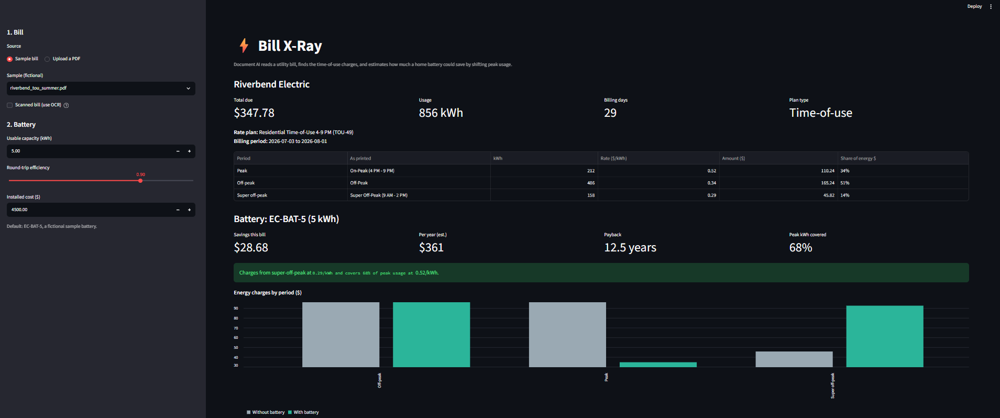
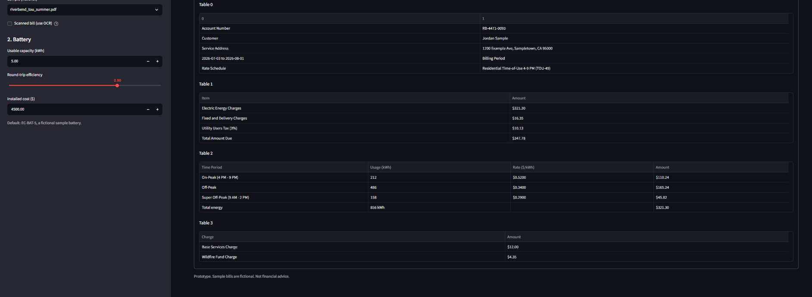
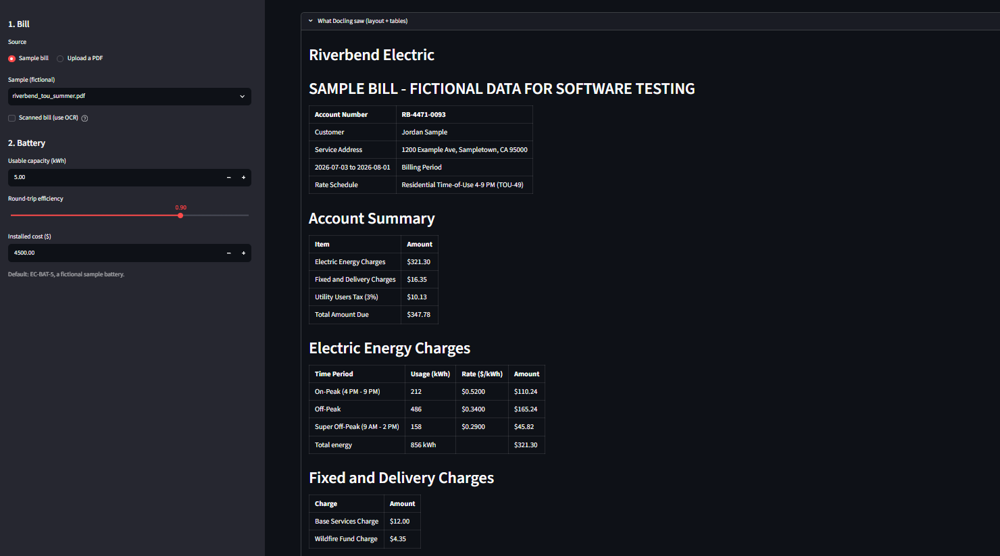
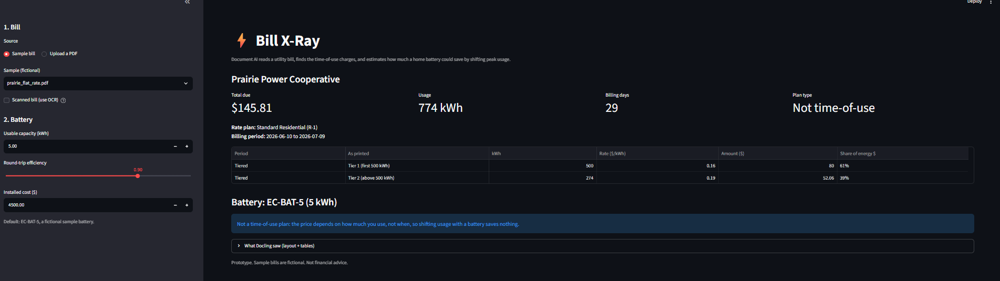
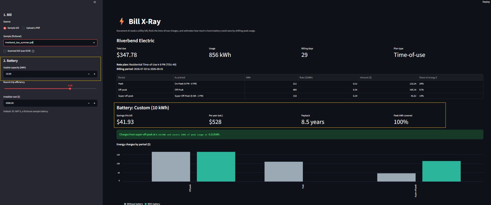

# ⚡ Bill X-Ray: Document AI for Utility Bills

> Drop in a utility bill PDF and get the rate plan, usage and time-of-use charges, plus how much a home battery could save by shifting peak load. **Docling** layout and table models recover the bill's structure, a **content-based extractor** reads the fields and cross-checks its own numbers.

[](https://github.com/docling-project/docling)
[](https://arxiv.org/abs/2408.09869)
[](https://streamlit.io/)
[](https://www.python.org/)
[](LICENSE)



---

## Overview

Time-of-use (TOU) rates charge much more for electricity in the late afternoon and evening. A home battery can charge when power is cheap and run the house at peak, but most homeowners can't read their own rate plan, let alone estimate what a battery would save. The numbers are all on the bill; they're buried in tables that look different at every utility.

Bill X-Ray turns a bill PDF into a decision:

| Step | How |
| :--- | :--- |
| See the page's structure | **Docling**: a layout model finds titles, text and tables; **TableFormer** rebuilds each table's rows and columns |
| Read the right fields | content-based extraction: plan, billing period, total due, kWh and $ for each TOU period |
| Check the numbers | cross-checks: kWh × rate = amount, periods sum to the printed total |
| Answer the business question | a battery model: savings this bill, per year, payback and before/after cost by period |
| Front End | Streamlit UI with what-if controls and a "What Docling saw" panel |

---

## Key Features

- **Works across layouts:** three sample utilities use different column orders, labels and number formats (`$0.5200`, `0.410 $/kWh`, `856 kWh`); columns are matched by header keywords, not position
- **Tolerates parser quirks:** handles swapped and split table cells that Docling produced on the sample bills
- **Validates itself:** with no answer key, a misread digit still surfaces as a warning in the UI
- **Classifies TOU periods:** peak, mid-peak, off-peak, super off-peak and tiered, from labels like "Peak 5-8 PM weekdays"
- **Knows when a battery won't help:** tiered (non-TOU) plans and rate gaps too small to cover battery losses get a plain explanation instead of a made-up saving
- **What-if controls:** battery capacity, round-trip efficiency and installed cost update results instantly because parsed bills are cached
- **Measured, not eyeballed:** synthetic bills come with an answer key, so field accuracy is a number
- **OCR toggle** for scanned bills

---

## System Architecture

```
bill PDF
   │
   ▼
parse.py ─ Docling pipeline (OCR off for born-digital PDFs)
         ─ layout model: regions labelled title / text / table / section header
         ─ TableFormer (ACCURATE mode): rows, columns, header cells
   │       output: Markdown + one pandas DataFrame per table
   ▼
extract.py ─ row_texts(): join each table row into one line
           ─ regex: date range anywhere, "Rate Schedule ...", "Total Amount Due"
           ─ energy table = the one with kWh + rate + amount columns (matched by header)
           ─ classify_period(): label → peak / off_peak / super_off_peak / tier
           ─ validate(): kWh × rate = amount, Σ periods = printed total, required fields present
   │
   ▼
battery.py ─ one cycle a day: charge in the cheapest period, discharge into peak
           ─ shift = min(battery capacity, actual daily peak use)
           ─ saving = shift × peak rate − (shift ÷ efficiency) × charge rate
   │
   ▼
app.py (Streamlit) ─ cache_resource: Docling models loaded once
                   ─ cache_data: parsed bill keyed by file bytes
                   ─ metrics, periods table, warnings, before/after chart, raw Docling view
```

| Input bill | What Docling recovered |
| :---: | :---: |
|  |  |

---

## Methodology

### 1. Synthetic Bills with an Answer Key

Real bills contain names, addresses and account numbers and no public dataset of US time-of-use bills exists. `make_bills.py` generates fictional bills with **reportlab** and writes `samples/expected.json`, the true value of every field. The three layouts are deliberately different:

| Bill | Plan | What makes it hard |
| :--- | :--- | :--- |
| Riverbend Electric (CA, summer) | Time-of-use 4–9 PM | three periods, including super off-peak; `$0.5200` rates |
| Lakeshore Energy Cooperative (MA, winter) | Time of day | columns reordered (rate before kWh), `0.410 $/kWh` format, no `$` on amounts |
| Prairie Power Cooperative (MN) | Tiered | no peak period at all; battery should report no savings |


### 2. Content-Based Extraction

| Field | Found by |
| :--- | :--- |
| Billing period | `YYYY-MM-DD to YYYY-MM-DD` anywhere in a joined row  |
| Rate plan | `Rate Schedule` followed by the rest of the joined row  |
| Total due | the row containing "Total Amount Due" |
| Energy table | the table with a kWh, a rate and an amount column |
| Columns | header keywords with exclusions, so `Price per kWh` is the rate column, not kWh |
| Period type | regex checks in order (super off-peak → off-peak → mid-peak → peak → tier), since "off-peak" contains "peak" |

### 3. Self-Validation

| Check | Catches |
| :--- | :--- |
| kWh × rate ≈ amount (±$0.05) | a misread digit, e.g. 212 read as 242 |
| Σ period kWh ≈ printed total | a missed or duplicated row |
| Plan, period and total due found | a layout the patterns don't recognise |
| Energy table found | an unsupported bill, reported instead of crashing |

### 5. Battery Load-Shift Model

| Quantity | Formula (Riverbend example) |
| :--- | :--- |
| Daily peak use | 212 kWh ÷ 29 days = 7.31 kWh |
| Daily shift | min(5 kWh battery, 7.31) = 5.0 kWh |
| Daily saving | 5 × $0.52 − (5 ÷ 0.90) × $0.29 = **$0.99** |
| This bill / year | × 29 days = **$28.68** · × 365 = **$361** |
| Payback | $4,500 ÷ $361 = **12.5 years** |

A battery only helps when **peak rate > charge rate ÷ round-trip efficiency**; otherwise losses eat the gap and the bill is reported as not eligible.

---

## Results

### Extraction accuracy

```
$ python extract.py
riverbend_tou_summer.pdf     6/6  all correct
lakeshore_tou_winter.pdf     6/6  all correct
prairie_flat_rate.pdf        6/6  all correct

Field accuracy: 18/18 = 100%
```

### Battery analysis (EC-BAT-5: 5 kWh, 90% efficiency, $4,500 installed)

| Bill | Peak covered | This bill | Per year | Payback |
| :--- | :---: | ---: | ---: | :---: |
| Riverbend (CA, summer) | 68% (battery-limited) | $28.68 | $361 | 12.5 yr |
| Lakeshore (MA, winter) | 100% (peak use < battery) | $19.78 | $249 | 18.1 yr |
| Prairie (MN, tiered) | n/a | not eligible | n/a | n/a |



### What-if: battery size

| Riverbend, battery capacity | Peak covered | This bill | Payback at $4,500 |
| :---: | :---: | ---: | :---: |
| 2 kWh | 27% | $11.47 | 31.2 yr |
| **5 kWh (default)** | **68%** | **$28.68** | **12.5 yr** |
| 10 kWh | 100% | $41.93 | 8.5 yr |

Doubling the battery doesn't double the savings, because the home only uses 7.3 kWh a day at peak.



**Takeaway:** shifting load alone rarely pays for a battery. The tool's value is **qualification**: it separates customers with large peak loads and wide rate gaps from those where a battery should be sold on backup power, incentives or solar instead.

---

## Repository Structure

```
bill-xray/
│
├── make_bills.py         
├── parse.py               
├── extract.py           
├── battery.py            
├── app.py                 
├── requirements.txt
├── pytest.ini            
│
├── samples/
│   ├── riverbend_tou_summer.pdf
│   ├── lakeshore_tou_winter.pdf
│   ├── prairie_flat_rate.pdf
│   └── expected.json     
│
├── tests/
│   ├── conftest.py      
│   ├── test_extract.py
│   ├── test_battery.py
│   └── test_samples.py    
│
└── docs/                
```

---

## Setup & Usage

### 1. Clone and install

```bash
git clone https://github.com/AI-Energy-Projects/bill-xray.git
cd bill-xray
python -m venv .venv
source .venv/bin/activate         
pip install -r requirements.txt
docling-tools models download     
```

### 2. Run the app

```bash
streamlit run app.py               ]
```

Pick a sample bill or upload a PDF in the sidebar, then adjust the battery settings.

### 3. Command line

```bash
python make_bills.py                                
python extract.py samples/riverbend_tou_summer.pdf  
python battery.py samples/riverbend_tou_summer.pdf 
python extract.py                                  
```

---

## Tests

```bash
python -m pytest -q            
python -m pytest -m docling -v  
```

| Area | What is checked |
| :--- | :--- |
| **Number parsing** | `$1,234.56`, `0.410 $/kWh`, `856 kWh`, blanks and `nan` |
| **Period classification** | off-peak and super off-peak are never classified as peak |
| **Column matching** | columns found by header in any order; "Energy Charge" in the label column isn't taken as the amount |
| **Safety net** | a planted misread digit triggers both cross-checks; a missing table warns instead of crashing |
| **Gap filling** | a blank rate is derived from amount ÷ kWh |
| **Battery model** | savings match a hand calculation; flat-rate bills are ineligible; shift capped by peak use; a small rate gap loses money; before − after = savings |
| **End to end** | every sample PDF matches `expected.json` with no warnings |

---

## Dependencies

```
docling>=2.15
reportlab>=4.0
streamlit>=1.40
pandas>=2.0
pytest>=8.0
```

---

## Limits

- **Clean sample bills.** Real bills add logos, multi-page layouts, charts and scans; OCR is available but untested here.
- **ISO dates only** (`2026-07-03`); formats like "Jul 3, 2026" aren't parsed yet.
- **One bill, one season.** The annual figure scales a single billing period; summer and winter rates differ.
- **Simple battery model.** Peak use is averaged over all days (some plans have weekday-only peaks); battery power (kW) limits, degradation and demand charges are ignored.
- **Not financial advice.** Estimates for comparison only.

---

## Next Steps

- LLM fallback for fields the patterns miss, constrained to Docling's output and checked by the same cross-checks
- Multi-month upload for a true annual estimate
- Add current battery incentives to payback via [IncentiveIQ](https://github.com/AI-Energy-Projects/incentive-iq)
- More layouts: scanned bills, multi-page bills, demand charges
- Replace the once-a-day rule with an optimized hour-by-hour schedule

---

## Author

Built by **Shriya Padhi** as part of [AI Energy Projects](https://github.com/AI-Energy-Projects), a portfolio of applied AI prototypes for home electrification, energy storage, grid resilience and severe weather.

All bills, utilities, customers and account numbers are **fictional**. The default battery, EC-BAT-5, is a fictional sample product.

---

## References

- Auer et al. [Docling Technical Report](https://arxiv.org/abs/2408.09869) (IBM Research, 2024)
- Nassar et al. [TableFormer: Table Structure Understanding with Transformers](https://arxiv.org/abs/2203.01017) (CVPR 2022)
- Pfitzmann et al. [DocLayNet: A Large Human-Annotated Dataset for Document-Layout Analysis](https://arxiv.org/abs/2206.01062) (KDD 2022)
- [Docling](https://github.com/docling-project/docling) · [Streamlit](https://docs.streamlit.io) · [reportlab](https://docs.reportlab.com)
